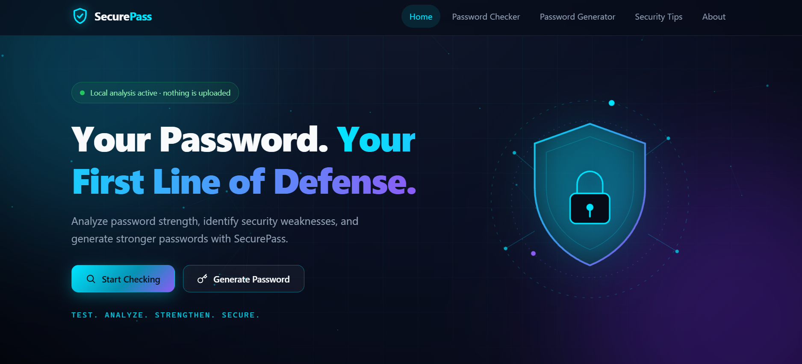
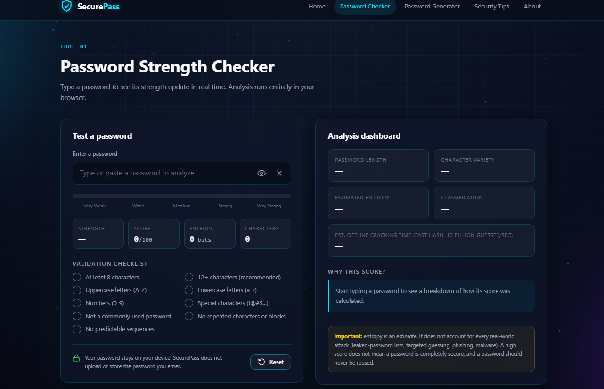
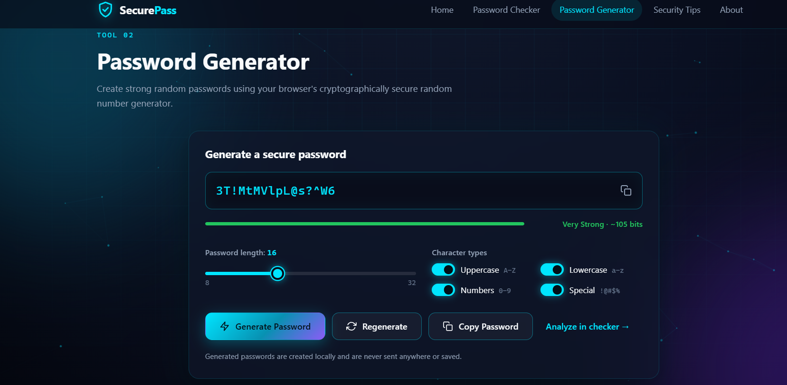

# 🛡️ SecurePass – Password Strength Checker

> **Test. Analyze. Strengthen. Secure.**

SecurePass is an educational cybersecurity project that demonstrates password security analysis, password strength estimation, entropy calculation, and secure password generation. It runs **100% in the browser** – no server, no database, no external APIs.


---

## ✨ Main Features

- **Real-time strength checking** – results update on every keystroke.
- **Five strength levels** – Very Weak, Weak, Medium, Strong, Very Strong (score 0–100).
- **Entropy estimation** – raw entropy vs. *effective* entropy after penalising predictable patterns.
- **Pattern detection** – common passwords, common words (including leetspeak such as `p@ssw0rd`), keyboard walks (`qwerty`), sequences (`abc`, `123`), repeats (`aaa`, `abcabc`) and years (`2024`).
- **Validation checklist** – 9 live checks (length, character types, common, repeats, sequences).
- **Analysis dashboard** – length, variety, entropy, classification, estimated offline cracking time, and a step-by-step explanation of *why* the score was given.
- **Dynamic recommendations** – advice changes depending on what is wrong with the password.
- **Secure password generator** – uses the **Web Crypto API** (`crypto.getRandomValues`), rejection sampling (no modulo bias) and a Fisher-Yates shuffle. Length 8–32, four character-type toggles, guaranteed at least one character from each selected type.
- **Copy to clipboard**, regenerate, and "analyze in checker" buttons.
- **Midnight Cyber Security theme** – animated grid, particles, glassmorphism cards, fully responsive.

## 🔒 Privacy

- Passwords are **never** sent to a server.
- Passwords are **never** stored (no `localStorage`, `sessionStorage`, cookies or database).
- Passwords are **never** written to the browser console.
- No external password-checking APIs and no external fonts, CDNs or libraries are loaded.
- The **Reset** button clears the entered password.

## 🧰 Technologies Used

| Layer | Technology |
|-------|-----------|
| Markup | HTML5 |
| Styling | CSS3 (variables, grid, flexbox, animations) |
| Logic | Vanilla JavaScript (ES6) |
| Randomness | Web Crypto API |
| Backend | None needed – everything is client-side (Python is only used optionally to serve the files locally) |

## 📁 Project Folder Structure

```
securepass/
├── index.html
├── css/
│   └── style.css
├── js/
│   ├── app.js                 # UI wiring, navigation, copy, background particles
│   ├── password-checker.js    # analysis, entropy, scoring
│   └── password-generator.js  # secure password generation
├── assets/
│   └── images/                # place your screenshots here
├── vercel.json                # optional security headers for Vercel
├── README.md
├── LICENSE
└── .gitignore
```


## 🌐 Deployment (optional)

SecurePass is a static site, so no build step is needed.

- **GitHub Pages:** Settings → Pages → Deploy from branch → `main` / root.
- **Vercel:** import the repo, Framework Preset **Other**, leave build settings empty. `vercel.json` adds a strict Content-Security-Policy so the page cannot load external scripts or make network requests.

## 🧮 How the Score Works

1. **Pool size** – lowercase (26) + uppercase (26) + digits (10) + symbols (33), only for types actually used.
2. **Raw entropy** = `length × log2(pool size)`.
3. **Pattern penalties** – predictable parts (common words, keyboard walks, sequences, repeats, years) are charged a small fixed cost instead of full entropy, giving the **effective entropy**.
4. **Score** = `effective entropy ÷ 100 × 100`, capped at 100.
5. **Caps** – common passwords are capped at 8; under 6 characters ≤ 15; under 8 characters ≤ 30; under 12 characters can't be "Very Strong".

| Score | Level |
|-------|-------|
| 0–19 | Very Weak |
| 20–39 | Weak |
| 40–59 | Medium |
| 60–79 | Strong |
| 80–100 | Very Strong |

> ⚠️ **Limitations:** entropy is an *estimate*. It does not model every real attack (leaked-password databases, targeted guessing, phishing, keyloggers). The built-in common-password list is small and offline. A high score never means a password is "completely secure", and passwords should never be reused.

## 📸 Screenshots

Add your screenshots to `assets/images/` and update the links below.

| Home | Checker |
|------|---------|
|  |  |

| Generator | Mobile |
|-----------|--------|
|  

## 🔮 Future Improvements

- Larger offline common-password list (loaded lazily).
- Passphrase (diceware-style) generator.
- Optional Flask backend/API for demonstrating server-side validation.
- Light theme and language selection.
- Unit-test suite for the checker.
- Offline-friendly PWA support.

## 📄 License

Released under the **MIT License** – see the [LICENSE](LICENSE) file.
